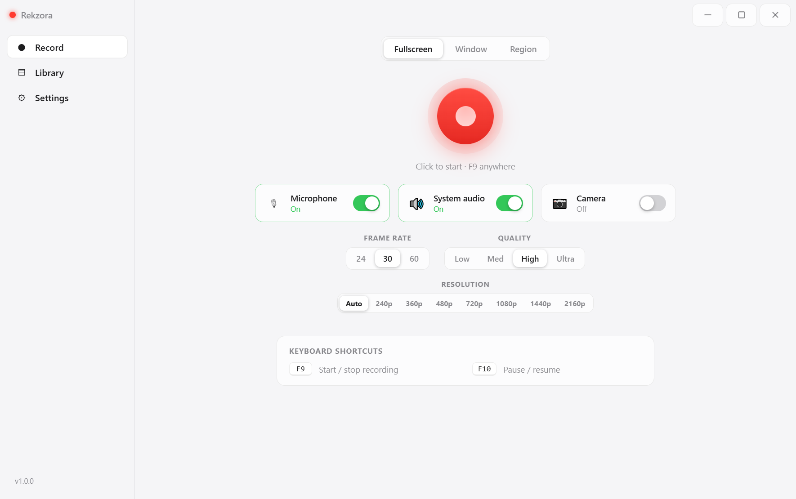
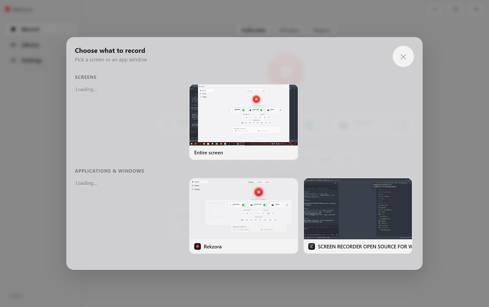
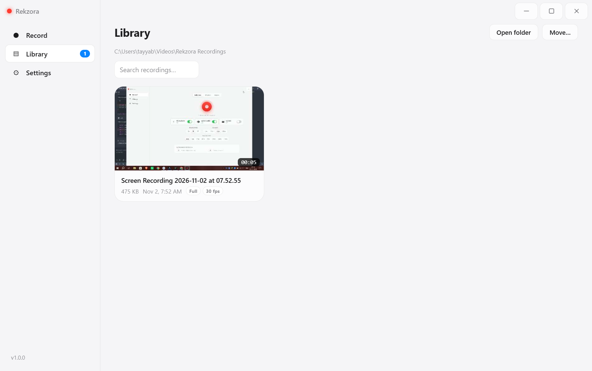
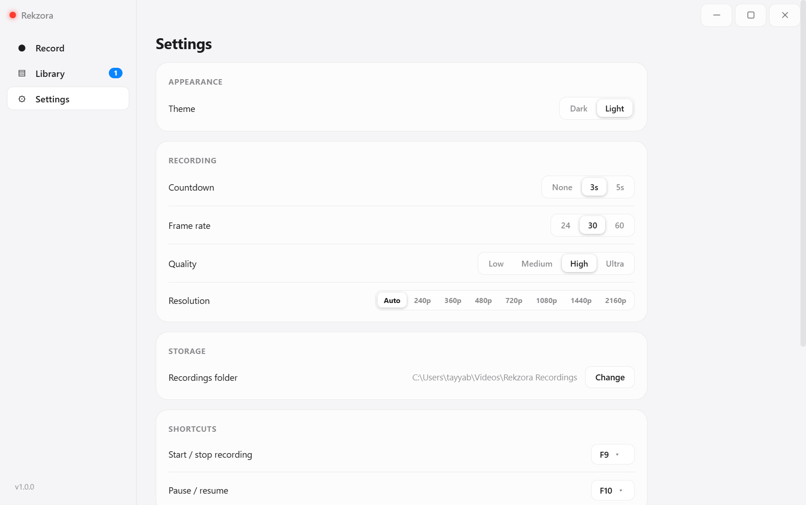

# ⏺ Rekzora — Screen Recorder for Windows

A beautiful, minimal, **open-source** screen recorder for Windows, built with **Electron**.
Clean, flat, translucent design with **native Windows-style title-bar buttons**, light & dark
themes, and an always-on-top floating control bar. Everything is offline and free — no account,
no cloud, no tracking, no watermark.

  

> **Rekzora** by **NEURON TS LABS** — Mohd Tahir Shaikh · 📧 tahirshaikh744@gmail.com · 🌐 [github.com/tahirshaikh744-design](https://github.com/tahirshaikh744-design)

## 📸 Screenshots

<p align="center">
  <a href="docs/screenshots/record.png"></a>
  <a href="docs/screenshots/picker.png"></a>
  <a href="docs/screenshots/library.png"></a>
  <a href="docs/screenshots/settings.png"></a>
</p>

*Record page (light theme) · live source picker · Library with a saved recording · Settings — dark theme available too.*

---

## ✨ Features

### Recording
- 🖥 **Fullscreen** — capture any connected display
- 🪟 **Window** — record a specific application window (follows it even when it moves)
- ✂️ **Region** — drag to select any area, with live size readout
- 🎙 **Microphone** — with noise suppression & auto gain
- 🔊 **System audio** — Windows loopback (what you hear is what you get)
- 📷 **Webcam overlay** — picture-in-picture bubble
- 📐 **Resolution control** — Auto / 240p / 360p / 480p / 720p / 1080p / 1440p / 2160p · presets scale *down* to the target's long edge (aspect kept, smaller sources are never upscaled); **Auto caps a 4K capture at the 2560-px long edge** so ultra-wide takes stay smooth and playable on ordinary hardware
- ⏱ **Countdown** — 3s / 5s / none *with capture pre-arming — recording starts the instant it hits zero*
- ⏸ **Pause / Resume** — media-quality pauses (no gaps in the timeline)
- 💾 **Crash-safe** — video is streamed to disk every second; if Rekzora is ever interrupted mid-recording, the take survives and a **Recovery banner** on the next launch offers to keep it into your Library or delete it — nothing hides in a temp folder

### Workflow
- 🧮 **Global hotkeys** — `F9` start/stop, `F10` pause/resume (rebindable)
- 🎛 **Floating bar** — always-on-top timer + controls; runs non-focusable so it never steals focus
- 📚 **Library** — searchable, with live thumbnails, metadata badges (**Recovered**/Partial included, so interrupted takes are labeled honestly), and filters
- ⋮ **Actions menu** — Play, Share, Rename, Show in folder, Copy path, Properties, Delete (left-click ⋮ or **right-click** a card)
- 📤 **Share sheet** — detected sharing apps on your PC (Google Quick Share, SHAREit, LocalSend, Send Anywhere, Xender, Telegram), or any app via "Open with…" · **native drag-out**: drag a Library card (or a player video) straight into Quick Share / SHAREit / any app window to attach and send
- 🔔 **Save toast** — every recording confirms with its title + full file path
- ▶️ **In-app player** — play, rename, delete, reveal in Explorer
- ⚙️ **Settings** — theme (dark/light), fps (24/30/60), quality presets that scale the video bitrate (**"Ultra" targets 24 Mbps at Full HD and scales with resolution, capped at a 42 Mbps ceiling** — it is a scaling slider, not a fixed number), save folder, countdown, tray behavior
- 🖥 **Tray** — keep Rekzora in the system tray; recordings continue while the window is hidden
- 🔋 **Suspend-aware** — automatically pauses if your PC goes to sleep

### Enterprise-friendly
- 🛡 **First-run Privacy Policy / EULA** — shown before anything else; "I Disagree" quits the app
- 🔇 **Private by design** — no telemetry, no accounts, no network calls of its own
- 👤 **Per-user installation** — the Setup requires **no administrator rights and shows no UAC prompt**

---

## 💻 Requirements

| | |
|---|---|
| **OS** | Windows 10 (build 1903+) or Windows 11, 64-bit |
| **For ready-made installers** | nothing else — just download and run |
| **For building from source** | [Git](https://git-scm.com/downloads) and [Node.js 22+](https://nodejs.org/) (the v22 LTS is recommended) |
| **Disk** | ~300 MB free for the app; more for your recordings |

---

# 📥 Installation

## Option A — Ready-made installers (recommended, zero tooling)

**Step 1.** Open the Releases page:

```
https://github.com/tahirshaikh744-design/rekzora/releases/latest
```

**Step 2.** Download the file you want:

| File | Best for |
|---|---|
| `Rekzora-Setup-1.1.0.exe` (~100 MB) | **Installed app** — Start-menu + desktop shortcuts; reinstalling over an older version keeps your recordings and settings. The recommended choice. |
| `Rekzora-Portable-1.1.0.exe` (~95 MB) | **No install at all** — one file you can keep on a USB stick or any folder |

*Exact sizes and SHA-256 hashes for every release artifact live in the release's checksums file — compare before you trust a download.*

**Step 3.** Run the file.

- **Setup**: the installation wizard opens. It installs **only for you** (`C:\Users\<you>\AppData\Local\Programs\Rekzora`) — no admin password, **no UAC prompt**, no reboot. Pick the folder if you like, then **Finish** (it launches Rekzora).
- **Portable Windows** may show a *SmartScreen* notice because the exe is not code-signed (signing requires a paid certificate). Click **More info → Run anyway**. This is expected for open-source apps without a certificate.

**Step 4.** First run: the **Privacy Policy / EULA** dialog appears. Read it, then click **I Agree** to start using Rekzora. Clicking **I Disagree** closes the app (nothing is installed of note; you can delete the folder).

**Step 5.** Rekzora is ready. Press `F9` anywhere in Windows to start/stop recording.

> Where things live:
> • App: `C:\Users\<you>\AppData\Local\Programs\Rekzora` · Recordings: `Videos\Rekzora Recordings`
> • Settings & library database: `C:\Users\<you>\AppData\Roaming\Rekzora`
> • Uninstall: Windows **Settings → Apps → Installed apps → Rekzora → Uninstall**

---

## Option B — Install from source (step-by-step, copy-paste)

Run each block in **PowerShell** (`Win + X → Terminal`). Each step tells you what it does.

### Step 1 — Install Git (skip if `git --version` works)

```powershell
winget install --id Git.Git -e --source winget
```

Close and reopen the Terminal afterwards so `git` is on PATH.

### Step 2 — Install Node.js LTS (skip if `node -v` already shows v22 or newer)

```powershell
winget install --id OpenJS.NodeJS.LTS -e --source winget
```

Close and reopen the Terminal, then verify both tools are on PATH:

```powershell
node -v
npm -v
git --version
```

*(No `winget`? Download Node.js from <https://nodejs.org/> and Git from <https://git-scm.com/downloads> instead.)*

### Step 3 — Clone the repository

```powershell
cd "$env:USERPROFILE\Desktop"
git clone https://github.com/tahirshaikh744-design/rekzora.git
cd rekzora
```

*Don't want Git? On the repo page choose **Code → Download ZIP**, extract it, then `cd` into the extracted folder instead.*

### Step 4 — Install dependencies

```powershell
npm install
```

This downloads Electron and the packaging toolchain (one-time, a few minutes).

### Step 5 — Run Rekzora in development mode

```powershell
npm start
```

Windows PowerShell users can also double-click **`Start-Rekzora.bat`** in the project folder — it launches the app and writes a log to `logs\rekzora.log`.

### Step 6 — Build the Windows installers (Setup + Portable)

```powershell
npm run dist
```

Output lands in the **`dist\`** folder:

| Artifact | Type |
|---|---|
| `dist\Rekzora-Setup-<version>.exe` | NSIS installer (per-user, EULA page) |
| `dist\Rekzora-Portable-<version>.exe` | Portable single-file exe |
| `dist\Rekzora-Setup-<version>.exe.blockmap` | delta-update metadata |
| `SHA256SUMS.txt` | checksums for the exe artifacts (CI builds) |

Need only one of them?

```powershell
npm run dist:installer   # only Rekzora-Setup-<version>.exe
npm run dist:portable    # only Rekzora-Portable-<version>.exe
```

There is also the helper script used by this project (installs deps first, then builds both):

```powershell
powershell -ExecutionPolicy Bypass -File scripts\build.ps1
```

### Step 7 — Optional: code signing

Unsigned exes are perfectly fine for a GitHub Release — Windows SmartScreen shows its "unknown publisher" notice until you buy an Authenticode certificate. If/when you have one, export it as `CSC_LINK` + `CSC_KEY_PASSWORD` environment variables and rebuild; the full procedure is in [`RELEASE.md`](RELEASE.md#4-code-signing-optional), §4.

---

## 🎬 Your first recording

1. Pick a mode in the sidebar: **Fullscreen** / **Window** / **Region**.
2. Toggle **Mic**, **System audio** and **Webcam** if you want them.
3. Press the big red **Record** button — a `3·2·1` countdown appears (configurable), then the floating control bar takes over.
4. `F10` pauses/resumes, `F9` stops. Or use the buttons on the floating bar.
5. On stop: a toast confirms the save (title + path) and your video appears in the **Library** — play, rename, share, or drag it straight into Quick Share / SHAREit / any app.

## 🔧 Keyboard shortcuts

| Key | Action |
| --- | --- |
| `F9` | Start / stop recording (works system-wide) |
| `F10` | Pause / resume (works system-wide) |
| `Esc` | Cancel region selection |

Hotkeys are rebindable in **Settings** (they are global — Rekzora may be minimized).

## 🗂 Where Rekzora keeps things

| Item | Location |
|---|---|
| Recordings (default) | `C:\Users\<you>\Videos\Rekzora Recordings` |
| Settings (`settings.json`) | `C:\Users\<you>\AppData\Roaming\Rekzora` |
| Library database (`library.json`) | `C:\Users\<you>\AppData\Roaming\Rekzora` |
| Temporary crash-safe chunks | `C:\Users\<you>\AppData\Roaming\Rekzora\recordings-tmp` |
| Logs (dev builds) | `<repo>\logs\rekzora.log` |

Everything above can be deleted to reset Rekzora to day one (no registry keys are ever written).

## 🧰 Troubleshooting

- **Windows SmartScreen flagged the exe** → it is unsigned (see *Code signing*). `More info → Run anyway`, or build from source yourself.
- **No UAC prompt appears when installing** → that is by design: per-user install (`requestExecutionLevel: asInvoker`), so nothing needs admin rights.
- **Recording is silent** → check the 🔊 *System audio* toggle and Windows volume mixer; the mic needs its own toggle + Windows privacy permission (`Settings → Privacy & security → Microphone`).
- **Windows report says recording is blocked** → allow desktop apps to use the camera/microphone in Windows Privacy settings.
- **Hotkeys do nothing** → another app (OBS, Game Bar…) may own F9/F10; rebind in Rekzora Settings.
- **Window recording shows black** → the target app is DRM/protected content (movies, some browsers) which Windows prevents from being captured.
- **High CPU when idle** → normal usage is near-zero; if you see otherwise, check `logs\rekzora.log` and open an issue.

## 🌐 Releases & CI

Every git tag `v*.*.*` (e.g. `v1.1.0`) pushed to GitHub triggers
[`.github/workflows/release.yml`](.github/workflows/release.yml), which then

1. **refuses to run** if the tag doesn't match `package.json`'s version,
2. installs dependencies reproducibly (`npm ci`),
3. runs the **regression suite** (70 tests) and the **headless smoke test**
   (a real 3-second recording through the real app; its exit code gates the build),
4. builds **Setup + Portable** *without* auto-publishing,
5. writes a **SHA-256 checksums file** for the exe artifacts (checkbox-based verification
   refuses to release with a missing artifact), and
6. creates the GitHub Release with the notes from `RELEASE-NOTES.md`, attaching
   both exes + `SHA256SUMS.txt` — nothing is published until tests, smoke, the
   version gate and the checksums have all passed.

Plain pushes to `main` and `workflow_dispatch` runs execute the **same test
pipeline** (checkout → tests → smoke → build → checksums) but skip the
publish step — so the quality gates run on every change, and a release can
only ever come from a version-matching tag.

Both actions are **pinned to exact commit SHAs** (no floating `@v4`-style tags). The release
checklist lives in [`RELEASE.md`](RELEASE.md).

To publish a release from this machine:

```powershell
git tag v1.1.0
git push origin v1.1.0
```

The tag must match `package.json`'s version — CI refuses mismatched tags.

## ✅ Regression tests

The repo ships a dependency-free test suite (69 tests) covering the recording
session state machine, IPC guard roles, share-launch registry, WebM probing,
crash manifests, the settings schema and the atomic JSON store:

```powershell
npm test        # runs `node --test`
npm run smoke   # headless live self-test (REKZORA_SMOKE=1, exit code honest)
```

## 🗂 Project structure

```
rekzora/
├── main.js                        # Electron main process: windows, IPC, tray, storage
├── preload.js                     # Secure contextBridge (window.rekzora API)
├── package.json                   # App identity + electron-builder config
├── Start-Rekzora.bat              # One-click dev launcher (logs to logs\rekzora.log)
├── lib/                           # Testable core modules (sessions, IPC guard,
│                                  #   manifests, WebM checks, share registry,
│                                  #   store, settings schema)
├── tests/                         # `node --test` regression suite (69 tests)
├── src/
│   ├── renderer/
│   │   ├── index.html             # App UI
│   │   ├── styles.css             # Design system (tokens, light/dark)
│   │   ├── app.js                 # UI controller (library, settings, picker)
│   │   └── recorder.js            # Capture + canvas + MediaRecorder engine
│   ├── floating/                  # Always-on-top floating control bar
│   └── region/                    # Region-selection overlay
├── build/
│   ├── license.txt / license.rtf  # Privacy Policy + EULA (single source of truth)
│   └── installer.nsh              # NSIS customization (EULA radio-button page)
├── scripts/
│   ├── build.ps1                  # Build both Windows artifacts
│   ├── make-icons.ps1             # Multi-resolution .ico generator
│   ├── make-license-rtf.cjs       # license.txt → license.rtf converter
│   ├── prepare-release.ps1        # GitHub release prep
│   ├── ps-parse-check.ps1         # PowerShell syntax validator
│   ├── test-quickshare.js         # Standalone check of Quick Share detection
│   ├── take-screenshots.cjs       # README screenshot driver (CDP, port 9222)
│   └── smoke-run.bat              # Headless 3-second self-test (REKZORA_SMOKE=1)
├── assets/                        # App icons
├── .github/workflows/release.yml  # Tag → GitHub Actions → Release
├── LICENSE                        # MIT
└── RELEASE.md                     # Release checklist + code-signing guide
```

## 🧠 How it works

1. `desktopCapturer` enumerates screens & windows; you pick one from the in-app source picker.
2. The main process approves `getDisplayMedia` via `setDisplayMediaRequestHandler` and
   injects **system audio loopback** (Windows-only capability).
3. Microphone and system audio are mixed through an `AudioContext` graph
   (the mic gets a gentle compressor to prevent clipping).
4. A hidden `<video>` feeds a `<canvas>` each frame — enabling region cropping and the
   webcam picture-in-picture — and `requestFrame()` drives the canvas capture track at an exact fps.
5. `MediaRecorder` (VP9/Opus WebM) is cut into 1-second chunks; the renderer
   streams chunks over IPC under a **main-owned session id** into a bounded
   write queue that appends them directly to a temp file on disk (crash-safe,
   with real backpressure — it ends the recording honestly instead of eating
   your RAM if the disk falls behind), then the file is atomically renamed
   into your recordings folder; crash manifests record progress so an
   interrupted take shows up in the recovery banner; metadata lives in the
   internal library database (no sidecar files in your videos folder), and
   playback streams through a main-owned `rekzora-video://` protocol that
   honors Range requests.

6. Every renderer call is validated against the IPC guard (source, role,
   message schema) and every settings write is schema-checked and landed
   atomically with a rolling backup.

## 🗺 Roadmap

- [ ] MP4 export (ffmpeg post-processing)
- [ ] Basic trim editor
- [ ] Auto-start with Windows
- [ ] Auto-updates via GitHub Releases

## 🤝 Contributing

Issues and PRs are welcome at [github.com/tahirshaikh744-design/rekzora/issues](https://github.com/tahirshaikh744-design/rekzora/issues)!
Please keep the design minimal and consistent.

## 📄 License

[MIT](LICENSE) © 2026 **NEURON TS LABS** — Mohd Tahir Shaikh · 🌐 [github.com/tahirshaikh744-design](https://github.com/tahirshaikh744-design)
