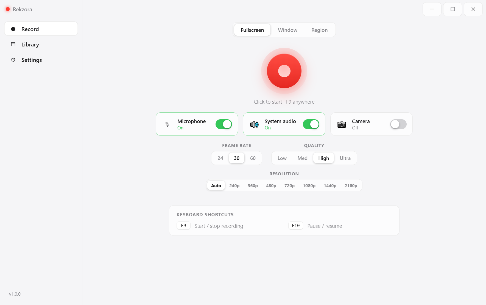
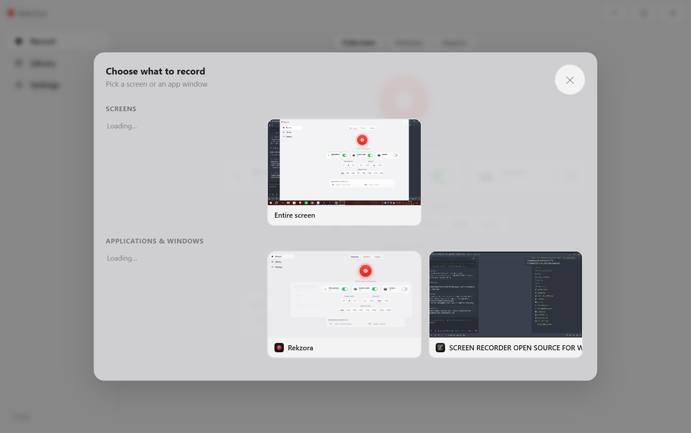
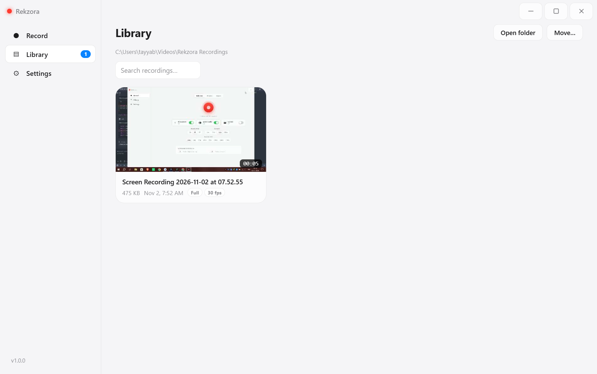
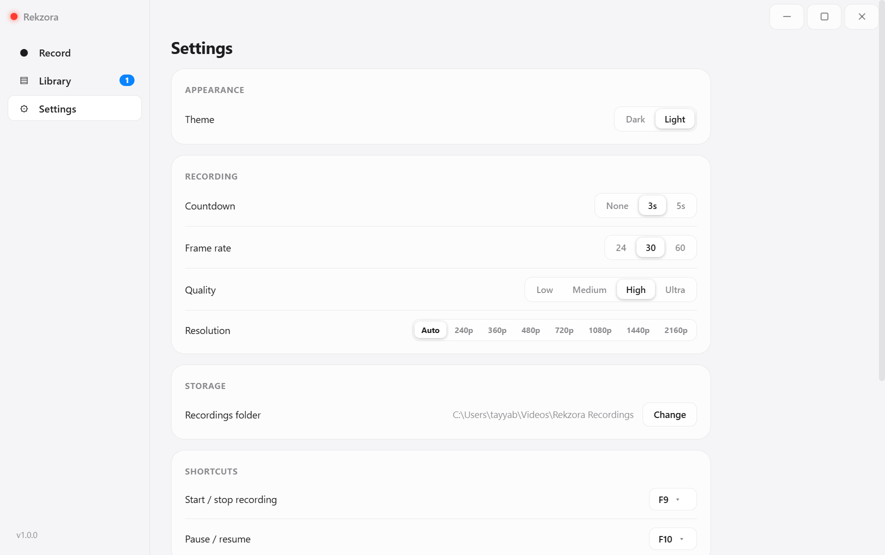

# 🚀 Rekzora 1.1.0 — Trust, Reliability & a Modern Runtime

**Rekzora** is a minimal, offline-first **screen recorder for Windows** — no account, no cloud, no watermark.
Now built on **Electron 45** · MIT licensed · by **NEURON TS LABS** (Mohd Tahir Shaikh).

<p align="center">
  <a href="docs/screenshots/record.png"></a>
  <a href="docs/screenshots/picker.png"></a>
  <a href="docs/screenshots/library.png"></a>
  <a href="docs/screenshots/settings.png"></a>
</p>

---

## ✨ What's new in v1.1.0

v1.1.0 is a hardening release: same minimal recorder you know from 1.0.0 — same features, same data formats — with its **internals rebuilt around trust, crash recovery and a machine-checked release pipeline**.

### 🔐 A hardened trust boundary
- **Main-owned capture sessions** — the renderer no longer invents session IDs. The main process mints, tracks and owns every capture session; the UI just asks.
- **IPC allow-list + sender guard** — every renderer message is checked against an explicit channel allow-list and its sender verified before anything happens. Unrecognized channels are refused, not ignored.
- **Share action registry** — sharing validates against known-good destinations instead of trusting whatever payload a web page hands over.
- **Tightened CSP & permission handlers** — the content-security policy is narrowed to exactly what the app needs, and permissions are granted deliberately, one by one.

### 🟢 Reliability
- **Automatic crash recovery** — after an unexpected crash, the last recording is rebuilt from its on-disk 1-second chunk trail and restored into the Library with **Recovered** / **Partial** badges, so you know exactly what you've got.
- **No more silent hangs** — a capture stream that produces **zero frames** (unusual GPU drivers, sandboxed displays…) now fails *honestly* with a clear message instead of freezing the recorder.
- **Tighter resource lifecycle** — capture tracks are released promptly on stop/quit, the chunk queue is memory-bounded, and quitting is a clean handshake instead of a hopeful process exit.

### 🗄 Storage & playback
- **Typed settings schema + atomic writes** — settings are validated against a strict schema and written atomically: a power cut mid-save can't leave a corrupt settings file.
- **Save-folder provisioning** — your save folder is created and verified at startup, so "folder missing" can't ambush you mid-recording.
- **Secured playback** — Library videos stream through a main-owned **`rekzora-video://`** protocol resolved via the library index, covered by an automated **playback probe** that proves a real recording actually plays, end to end.
- **Bounded thumbnails** — Library thumbnails are memory-bounded; a long recording list stays light.

### 🏭 Release quality (new in how Rekzora ships)
- **Quality-gated CI** — a tag can only become a Release if the tag matches the version in `package.json`, all **70 regression tests** pass, and a **headless smoke test records a real video from a real app window** on the CI runner. Nothing is published when any gate fails.
- **`SHA256SUMS.txt`** — every release ships a checksums file for both exes (see 📦 below).
- **Supply-chain hardening** — every third-party action pinned to an exact commit SHA, and every build path runs `--publish never` so artifacts land only on the verified release.
- **New: one-click `build.cmd`** — a branded local builder at the repo root. Double-click it and it detects tooling, installs what's missing, builds Setup + Portable, writes checksums, and shows honest exit codes with diagnostics when anything fails.

And the foundation: **Electron 38 → 45.2.3**, the current Electron line, with the full 1.0.0 feature set verified working on top (same recording pipeline, same WebM chunk format, same library).

---

## 🔐 Offline & private — unchanged in 1.1.0

No new online features in this release; the app's behavior with the outside world is the same as 1.0.0. What changed is *how the app talks to itself internally* — main-process ownership, IPC allow-listing, CSP tightening.

| Guarantee | How |
|---|---|
| **Local-first by design** | Record, save, play back and share on your own machine — sharing hands a real file to an app you choose. |
| **First-run consent** | Full **Privacy Policy / EULA** on first start. Declining closes the app; nothing is stored if you decline. |
| **No-admin installation** | The Setup is **per-user** (`asInvoker`, NSIS `perMachine: false`) — **no UAC prompt**, no admin password, no reboot. |
| **Clean data model** | Recordings + settings + library database are plain files you can delete any time. No registry keys are ever written. |

---

## 🧪 What was tested — and what's still manual

| Check | Status |
|---|---|
| Regression suite (70 tests) | ✅ **70/70** passing locally on the release commit; required for CI release builds |
| Headless smoke test (real window → real recording → playback probe) | ✅ PASSED on real Windows hardware with an honest exit-code runner |
| Full local builds (`build.cmd all`) | ✅ Setup + Portable + checksums produced end-to-end, twice |
| Multi-monitor edge cases, USB / Bluetooth microphones, webcam-in-video capture, antivirus / VirusTotal remarks | 📌 **NOT EXECUTED** — tracked openly in [docs/REKZORA_TEST_REPORT.md §9](https://github.com/tahirshaikh744-design/rekzora/blob/main/docs/REKZORA_TEST_REPORT.md). All features apply the full test-suite hardening; the per-device validation has not been claimed as done. |

---

## 📥 Installation (3 options)

**Option A — Installer (recommended):**

```text
1. Download Rekzora-Setup-1.1.0.exe (from the Assets below)
2. Run it — per-user install, no UAC, EULA included
3. Click I Agree → Finish
```

**Option B — Portable (no install):**

```text
1. Download Rekzora-Portable-1.1.0.exe
2. Double-click it from any folder (even a USB stick)
```

**Option C — From source:**

```text
git clone https://github.com/tahirshaikh744-design/rekzora.git
cd rekzora
build.cmd            ← Windows: double-click. Detects everything, builds both exes.

# manual route:
npm install
node node_modules\electron\install.js   ← Electron 45 ships no auto-download hook
npm start            # dev mode
npm run dist         # build both Windows artifacts
```

Where things live: recordings `Videos\Rekzora Recordings` · settings `%APPDATA%\Rekzora\settings.json` · library DB `%APPDATA%\Rekzora\library.json`.

---

## 📦 Artifacts

| Artifact | Type | Size |
|---|---|---|
| `Rekzora-Setup-1.1.0.exe` | NSIS installer · per-user · EULA page | ≈ 116 MB |
| `Rekzora-Portable-1.1.0.exe` | single-file portable exe | ≈ 106 MB |
| `SHA256SUMS.txt` | SHA-256 checksums of both exes | < 1 KB |

<details>
<summary>Verify checksums (after downloading)</summary>

```powershell
Get-Content .\SHA256SUMS.txt
Get-FileHash .\Rekzora-Setup-1.1.0.exe -Algorithm SHA256
Get-FileHash .\Rekzora-Portable-1.1.0.exe -Algorithm SHA256
```
The hashes must match the two lines in `SHA256SUMS.txt`. Sizes may vary a little per build; the checksum gives you the definitive identity.
</details>

---

## 🧯 Known limitations in 1.1.0

- **Storage format is WebM (VP9 + Opus).** Universal on Windows, plays in the in-app player, VLC and modern browsers; MP4 export via ffmpeg is on the roadmap.
- **DRM-protected windows record as black** (Netflix, some protected browser content) — this is a Windows-level restriction no screen recorder can bypass.
- **Windows privacy gates** — microphone/camera access must be allowed for desktop apps in `Settings → Privacy & security` (standard for any recorder).
- **Unsigned binaries** — Windows SmartScreen may show "unknown publisher" on first run (click *More info → Run anyway*). This goes away only with a paid Authenticode certificate.
- **Hotkeys can be claimed** — if OBS / Game Bar etc. already own F9/F10, rebind Rekzora's in Settings.
- **Auto resolution caps a very large capture at the 2560-px long edge** — keeps ultra-wide takes smooth and playable on ordinary hardware; you can still force 2160p manually, and smaller sources are never upscaled.
- **Quality presets are a scaling slider** — presets scale the video bitrate *with* the resolution (targeting 24 Mbps at Full HD, capped at a 42 Mbps ceiling) — not a fixed number.

---

## 🚀 What's next (Roadmap)

- [ ] MP4 export (ffmpeg post-processing)
- [ ] Trim editor
- [ ] Auto-start with Windows
- [ ] Auto-updates via GitHub Releases (payload already blockmap-ready)
- [ ] Optional small always-on-top webcam window

See the full list in the README's Roadmap section.

---

## 🙌 Credits

Built by **Mohd Tahir Shaikh** ([@tahirshaikh744-design](https://github.com/tahirshaikh744-design)) · Brand: **NEURON TS LABS** 🇮🇳
Stack: Electron 45.2.3 · Chromium display-capture · zero runtime npm dependencies.

**Full Changelog**: https://github.com/tahirshaikh744-design/rekzora/compare/v1.0.0...v1.1.0

---

> *Rekzora is open source under the MIT license. If it saves you time, a GitHub ⭐ helps others find it.*
